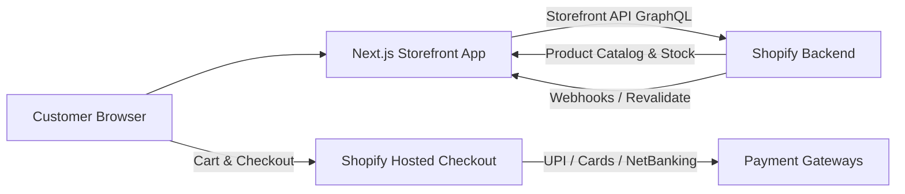

# NISA (నిస) — Shopify Headless Storefront Integration Guide

This guide explains how your existing high-performance Next.js website connects directly to your Shopify store as a **Headless Storefront (Custom Theme)**.

---

## 🏗️ Architecture Overview 



- **Frontend (Your Website)**: Next.js (App Router), Tailwind CSS, Lucide icons, dynamic carousels, responsive cart drawer, and interactive product pages.
- **Backend (Shopify)**: Product catalog, variant pricing (250g, 500g, 1kg), inventory tracking, coupon code engine, taxes, customer orders, and PCI-compliant checkout.
- **Graceful Fallback**: If Shopify credentials are not set or during local development, the site automatically falls back to Supabase/mock data without breaking.

---

## 🔑 Step 1: Generate Shopify Storefront API Credentials

1. Log into your **Shopify Admin** (`https://admin.shopify.com/store/YOUR-STORE-NAME`).
2. In the left sidebar, click **Settings** (bottom left gear icon) ➔ **Apps and sales channels**.
3. Click **Develop apps** (if prompted, click *Allow custom app development*).
4. Click **Create an app**:
   - App Name: `Nisa Headless Storefront`
   - App developer: select your email
   - Click **Create app**.
5. In the **Configuration** tab, find **Storefront API integration** and click **Configure**.
6. Check the following **Storefront API access scopes**:
   - ✅ `unauthenticated_read_product_listings`
   - ✅ `unauthenticated_read_product_inventory`
   - ✅ `unauthenticated_read_product_tags`
   - ✅ `unauthenticated_write_checkouts`
   - ✅ `unauthenticated_read_checkouts`
   - ✅ `unauthenticated_write_customers`
   - ✅ `unauthenticated_read_customers`
7. Click **Save** in the top right.
8. Go to the **API credentials** tab and click **Install app**. Confirm by clicking **Install**.
9. In the **Storefront API access token** section:
   - Click **Reveal token once** (or copy the Public Storefront token).
   - Copy this token.

---

## ⚙️ Step 2: Configure Environment Variables

Open [.env.local](file:///Users/sateshgavara/Desktop/Agency/Nisa/.env.local) and enter your store domain and token:

```env
# ── Shopify Headless Storefront Integration ──
NEXT_PUBLIC_SHOPIFY_STORE_DOMAIN=your-store-name.myshopify.com
NEXT_PUBLIC_SHOPIFY_STOREFRONT_ACCESS_TOKEN=your_storefront_access_token_here
SHOPIFY_STOREFRONT_API_VERSION=2025-01
SHOPIFY_REVALIDATION_SECRET=nisa_super_secret_revalidation_key
```

> **Note**: For `NEXT_PUBLIC_SHOPIFY_STORE_DOMAIN`, use your `.myshopify.com` domain (e.g. `nisa-foods.myshopify.com`) or your primary custom Shopify domain.

---

## 📦 Step 3: Setting Up Products in Shopify Admin

To match the rich UI and features of NISA, format your Shopify products with the following:

### 1. Product Title & Description
- **Title**: e.g., `Guntur Boneless Mutton Pickle (మేక మాంసం ఆవకాయ)`
- **Description**: Add your authentic kitchen story, cooking notes, and pairing suggestions.

### 2. Variants (Sizes & Weights)
- Under **Options**, check **This product has options** (e.g. Size).
- Option Name: `Size`
- Option Values: `250g`, `500g`, `1kg`
- Set the individual **Price** and **Compare-at price** (for discount calculation) for each variant.
- In the variant weight field, set `250` g, `500` g, `1000` g. The normalizer automatically parses and displays size labels (`250g`, `500g`, `1kg`) in the UI.

### 3. Tags for Automatic Badges & Categories
Add any of these tags in Shopify Admin:
- `bestseller` or `best-seller` ➔ Displays the 🔥 **Bestseller** badge on the product card.
- `featured` ➔ Displays on the homepage featured section.
- `non-veg-pickle` ➔ Categorizes under Non-Veg Pickles.
- `podi` ➔ Categorizes under Podis & Powders.
- `sweet` ➔ Categorizes under Traditional Andhra Sweets.

### 4. Custom Metafields (Optional)
Under **Settings ➔ Custom data ➔ Products**, you can add definition metafields in the `custom` namespace:
- `ingredients` (Single line text / list)
- `shelf_life` (Single line text, e.g. "6 Months")
- `storage_info` (Multi-line text)
- `preparation_info` (Multi-line text)

---

## 🛒 Step 4: Cart & Shopify Checkout Flow

1. When a customer adds items to the cart, the cart drawer updates immediately in real-time.
2. Clicking **PROCEED TO CHECKOUT** or **BUY NOW** calls [/api/shopify/cart](file:///Users/sateshgavara/Desktop/Agency/Nisa/src/app/api/shopify/cart/route.ts).
3. The server generates a Shopify Cart and returns the official, secure **Shopify Checkout URL**.
4. The customer is redirected directly to Shopify's high-converting, mobile-optimized checkout:
   - Full support for Indian payment methods (UPI, GPay, PhonePe, Paytm, Credit/Debit cards, Net Banking, COD).
   - Auto-address lookup and PIN code verification.
   - Built-in discount code validation.
   - Automatic order confirmation SMS & emails sent by Shopify.

---

## 🔄 Step 5: On-Demand Revalidation Webhooks

When you update prices or add new products in Shopify Admin, Next.js can update pages instantly:

1. In Shopify Admin, go to **Settings ➔ Notifications ➔ Webhooks** (or via your app).
2. Create webhooks:
   - Event: `Product creation`, `Product update`, `Product deletion`
   - Format: `JSON`
   - URL: `https://your-domain.com/api/shopify/revalidate`
3. Whenever a product is changed, Next.js revalidates `/products`, `/`, and the product detail page on-demand.

---

## 🚀 Step 6: Testing & Going Live

1. Start your local dev server:
   ```bash
   npm run dev
   ```
2. Open `http://localhost:3000`.
3. Check [/api/products](file:///Users/sateshgavara/Desktop/Agency/Nisa/src/app/api/products/route.ts) in your browser:
   - When Shopify is connected, it will return your live Shopify products.
4. Try adding an item to the cart and clicking **PROCEED TO CHECKOUT** — you will be redirected to your Shopify store's checkout page!
